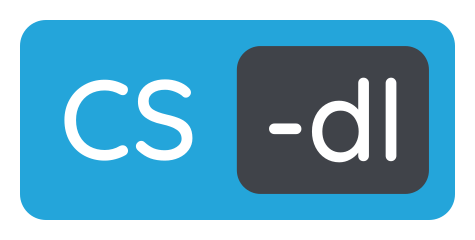
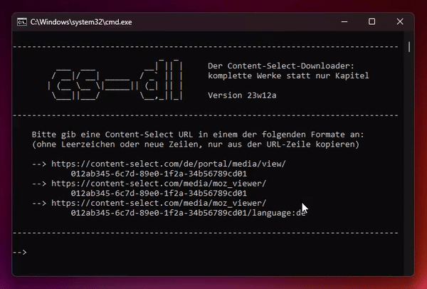

Readme zu cs-dl
===============

**cs-dl ist ein Skript für Windows**, mit dem sich eBooks von der Plattform [Content-Select](https://content-select.com) in vollem Umfang und ohne hässliche Wasserzeichen herunterladen lassen.

# Installation und Nutzung

> ⚠️ **Grundvoraussetzung:** Die IP-Adresse, mit welcher das Skript im Hintergrund auf die Inhalte zugreift, muss sich auf einer Whitelist von Content-Select befinden. Oft ist das der Fall, wenn man über das WLAN oder VPN einer Universität verbunden ist.

1. Klicke auf den Button `<> Code ▾` und im Pop-Up unten auf [`Download ZIP`](https://github.com/anemisus/cs-dl/archive/refs/heads/main.zip).
2. Entpacke die heruntergeladene ZIP-Datei auf deinem Rechner.
3. Navigiere in den Ordner `cs-dl-main`.
4. Führe das Skript `cs-dl.bat` aus.
5. Folge den Anweisungen auf dem Bildschirm.

# FAQ

## F: Was ist das Problem mit Content-Select?

A: Normalerweise erlaubt Content-Select nur den Download einzelner Kapitel aus eBooks. Die so über einen Browser heruntergeladenen Dateien enthalten außerdem ein sichtbares Wasserzeichen auf jeder einzelnen Seite.

Aus dieser **Design-Entscheidung** ergeben sich **folgende Nachteile**:

- Die Bücher sind nicht mehr komplett digital durchsuchbar (`STRG + F`).
- Durch die vielen Dateien geht schnell die Übersicht verloren.
- Die Einbindung in [Literaturverwaltungssoftware](https://www.zotero.org) wird erschwert.
- Das Wasserzeichen ist optisch störend wie Fettflecken oder Eselsohren.
- Es ist hart nervig, 20 Kapitel einzeln ziehen zu müssen.

👋 Hey Content-Select, diese [Enshittification](https://de.wikipedia.org/wiki/Enshittification) nervt total. Wir wollen einfach nur vernünftig arbeiten. Wie wäre es, wenn ihr das einseht und aufhört, uns dabei zu behindern?

## F: Wo finde ich mein Buch?

A: Die fertigen Dateien landen im Hauptordner, wo auch das Skript liegt.

## F: Warum dauert das so lange?

A: Um Inhalte von Content-Select herunterzuladen, muss eine Authentifizierung gegenüber dem Server stattfinden. Seit Mitte 2026 läuft der reine Verbindungsaufbau schneller als vorher. Mit der Umstellung wurde die Authentifizierung aber etwas komplexer und beinhaltet nun das Lösen einer Javascript-Challenge, was ein wenig Zeit benötigt. Und aus vormals nur einem Cookie sind mittlerweile zwei geworden.

💡 **Sobald die Cookies zugeteilt wurden, können sie mehrfach benutzt werden.**

Falls mehr du mehr als ein Buch herunterladen möchtest, starte daher nicht jedes Mal das Skript neu. Drücke nach erfolgtem Download eine beliebige Taste, um die Cookies weiter zu verwenden und so die Wartezeit ab dem zweiten Download zu verkürzen.

## F: Ist das überhaupt erlaubt?

A: Vermutlich schon. Der Download ist nur Personen möglich, die grundsätzlich dazu berechtigt sind.

🧸 **Das Skript nutzt keine Sicherheitslücken aus.**

Es simuliert lediglich einen Browser, der die einzelnen Kapitel nacheinander abruft. Am Ende werden die Inhalte dann lokal zu einem kompletten Werk zusammengefügt. Man könnte das auch manuell erledigen.

## F: Warum funktioniert es nicht?

A: Schwer zu sagen. Vielleicht ist die Authentifizierung fehlgeschlagen oder Skript beinhaltet einen Fehler?

Es kann aber auch sein, dass Content-Select eine Änderung an der Plattform vorgenommen hat, mit der das Skript noch nicht umgehen kann. Warte in diesem Fall auf ein Update.

## F: Fingerprint des Signaturschlüssels?

A: Er lautet `804ABD4A66A66E5242131FAB14AAF2972A56D0F8`.

Du kannst den Schlüssel z. B. auf [keys.openpgp.org](https://keys.openpgp.org) suchen und herunterladen.

# Lizenzen und Quellen

Alle Bestandteile dieser Software wurden unter freien Lizenzen veröffentlicht. Dafür bedanke ich mich bei den Autor_innen und verlinke hier die Details und Quellen:

Software  | Version | Lizenz                                                                 | Quellen
--------- | ------- | ---------------------------------------------------------------------- | ------------------------------------
curl      | 8.0.1   | [MIT-Lizenz (modifiziert)](https://curl.se/docs/copyright.html)        | https://github.com/curl/curl-for-win
grep      | 2.5.4   | [GNU GPLv3](https://www.gnu.org/licenses/gpl-3.0.en.html)              | https://sourceforge.net/projects/gnuwin32/files/grep/2.5.4
pdftk     | 2.02    | [GNU GPLv3](https://www.gnu.org/licenses/gpl-3.0.en.html)              | https://www.pdflabs.com/tools/pdftk-server
phantomjs | 2.1.1   | [BSD-Lizenz](https://opensource.org/license/bsd-3-clause)              | https://phantomjs.org
recode    | 3.6     | [GNU GPLv2](https://www.gnu.org/licenses/old-licenses/gpl-2.0.en.html) | https://sourceforge.net/projects/unxutils/files/unxutils/current
sed       | 4.2.1   | [GNU GPLv3](https://www.gnu.org/licenses/gpl-3.0.en.html)              | https://sourceforge.net/projects/gnuwin32/files/sed/4.2.1

